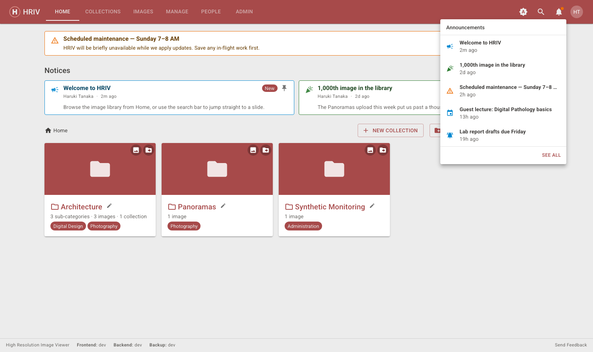
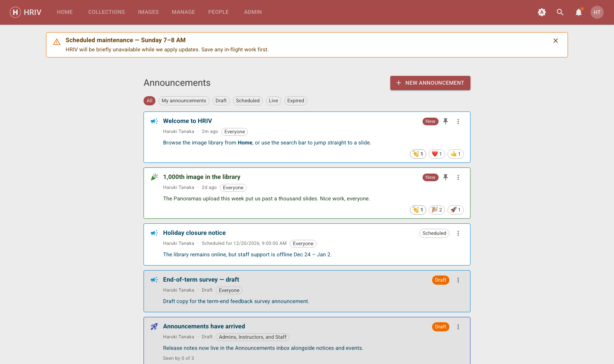
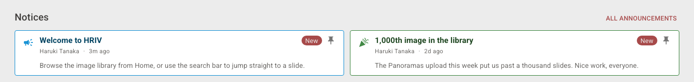
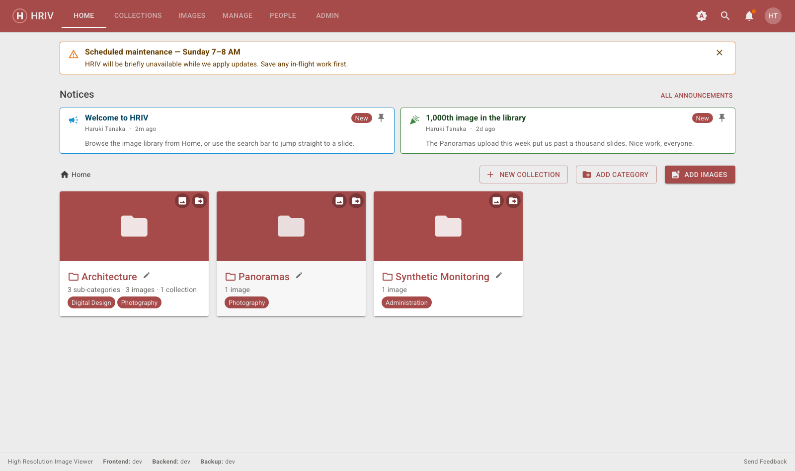
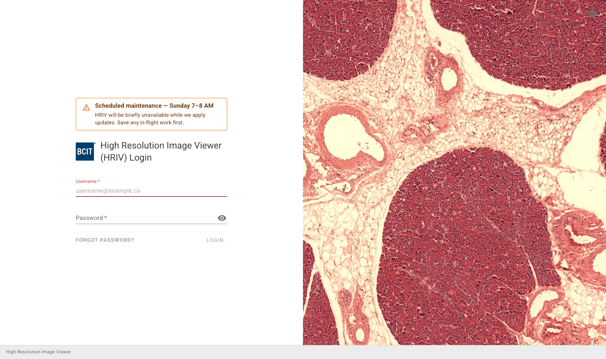
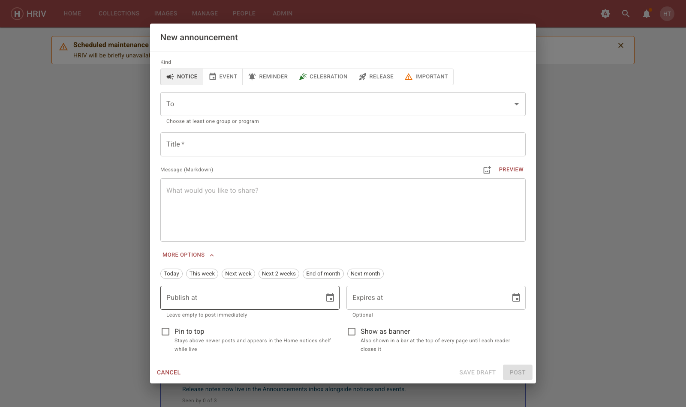
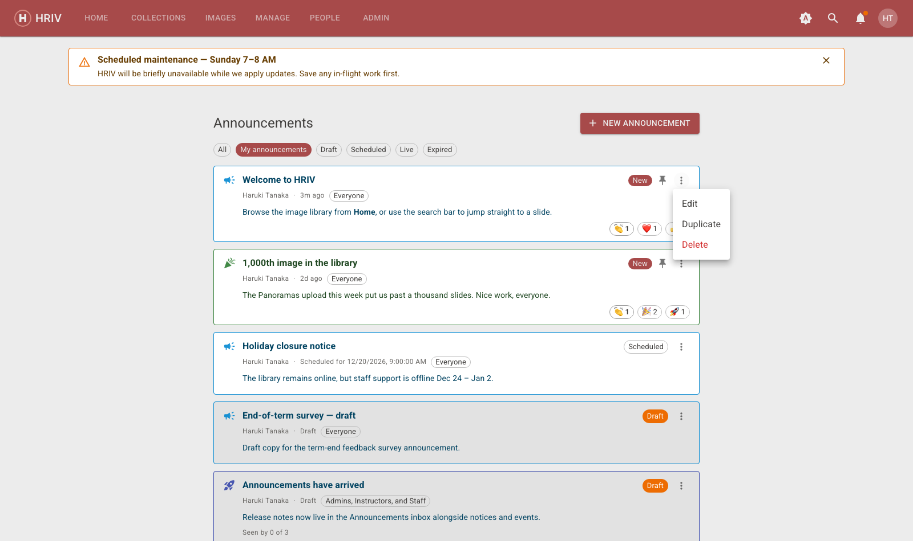

# Announcements

One stream for class notices, events, reminders, and release notes.
An amber dot on the **bell** means something's new.

## Reading

- Click the **bell** to peek at the newest posts — **See all** opens the
  full **Inbox**.
- **Pinned** posts sit on the **Home** notices shelf; **banner** posts
  appear across the top of the app until closed — and on the sign-in
  screen when they're addressed to **Everyone**.
- Tap an emoji under a post to react. Seen posts stay in the Inbox,
  quieter — readers can't dismiss them.

## Posting

Instructors and admins: **New announcement** on the Announcements page —
or **Post to group** from a group's row menu to pre-fill the audience.

1. **To:** — pick your groups and/or programs. Admins can also reach
   **Everyone** or staff audiences.
2. Choose an icon (notice, event, reminder, celebration…) and write the
   message — Markdown, images, and video all work.
3. **More options**: schedule publish and expiry, pin it, or show it as
   the app banner.
4. **Post** — or **Save draft** to finish later. Set a future date and
   the button becomes **Schedule**.

::: tip Edits don't re-notify
Changing a post does not resurface it. Tick **Notify readers again** on
an edit only when readers should see it as new.
:::

## Tracking your posts

**My announcements** shows only your own posts; the status filters —
Draft, Scheduled, Live, Expired — narrow any view by state. Staff see
**Seen by N of M** counts, plus Edit, Duplicate, and Delete on the card
menu.
