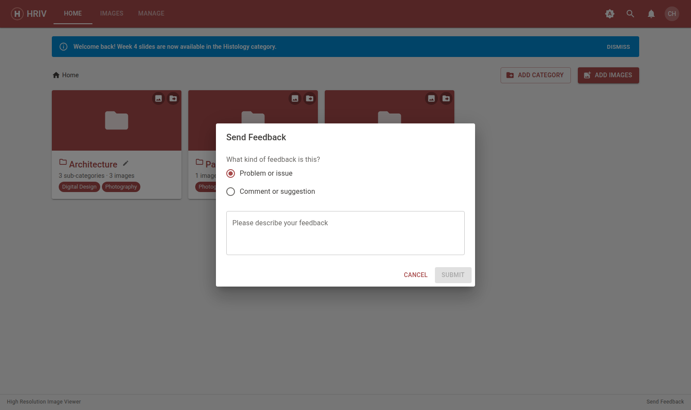
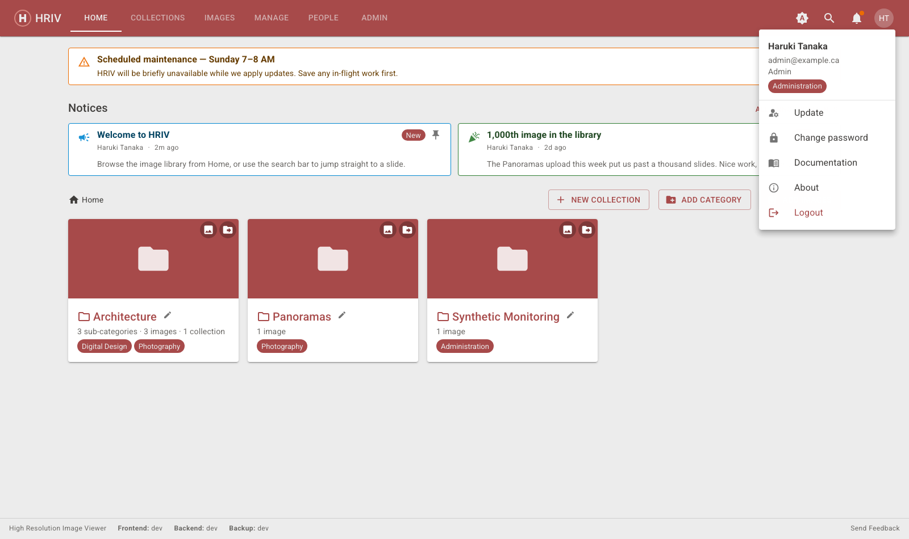

# Getting Help

## Send feedback

Click **Send Feedback** at the bottom of any page — found in the footer
next to the version numbers.

- Pick **Problem or issue** or **Comment or suggestion**.
- Describe what's wrong (or what you'd like to see) and press **Submit**.
- The feedback goes straight to the HRIV team, along with which page you
  were on.

## Other spots to check

- The **bell icon** (top right) opens your announcements — release notes
  land there too.
- Your **avatar menu** (top right) holds **Documentation** (this guide)
  and **About** — the About dialog shows the running version, handy to
  mention when reporting a problem.
- Need to reach a person? Contact the BCIT Teaching and Learning Unit.
- The footer also links to the **HRIV project on GitHub** for the
  technically curious.

